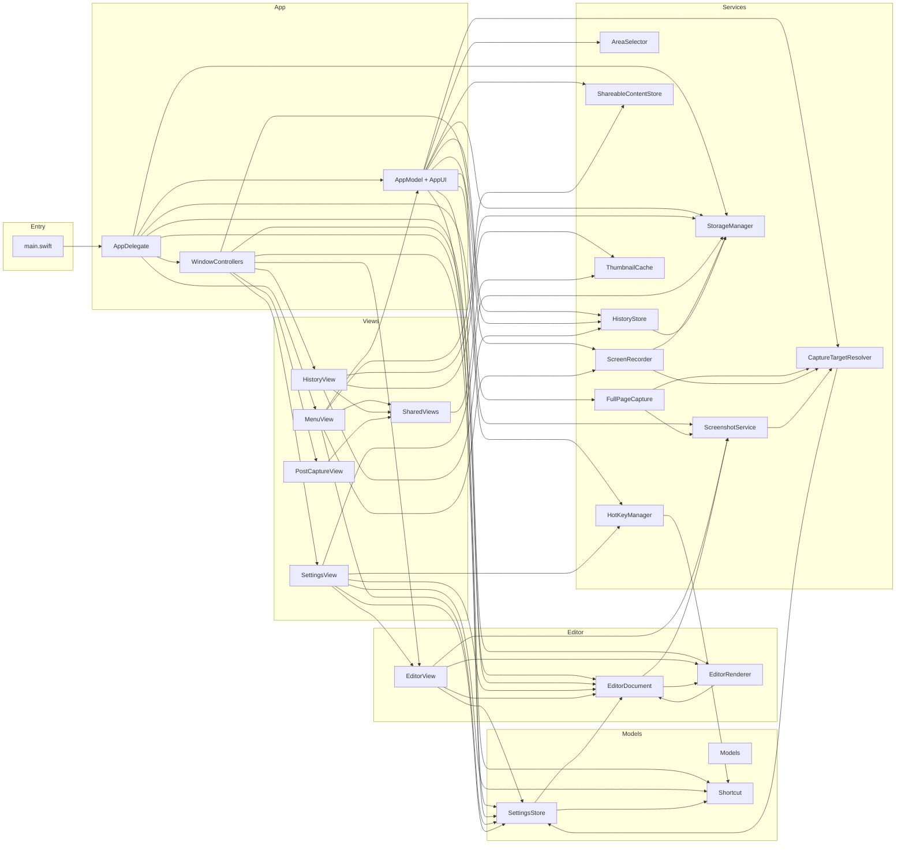
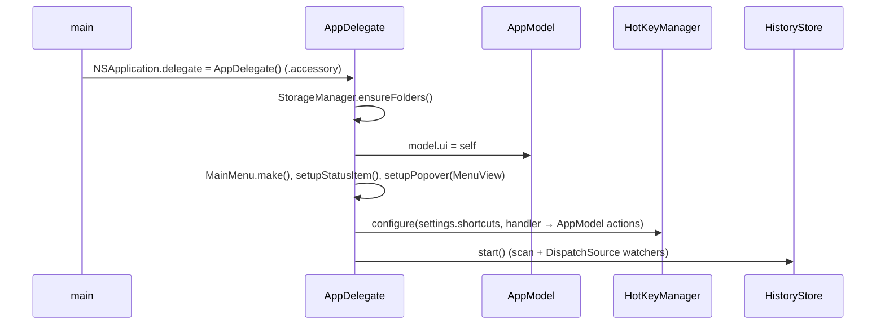
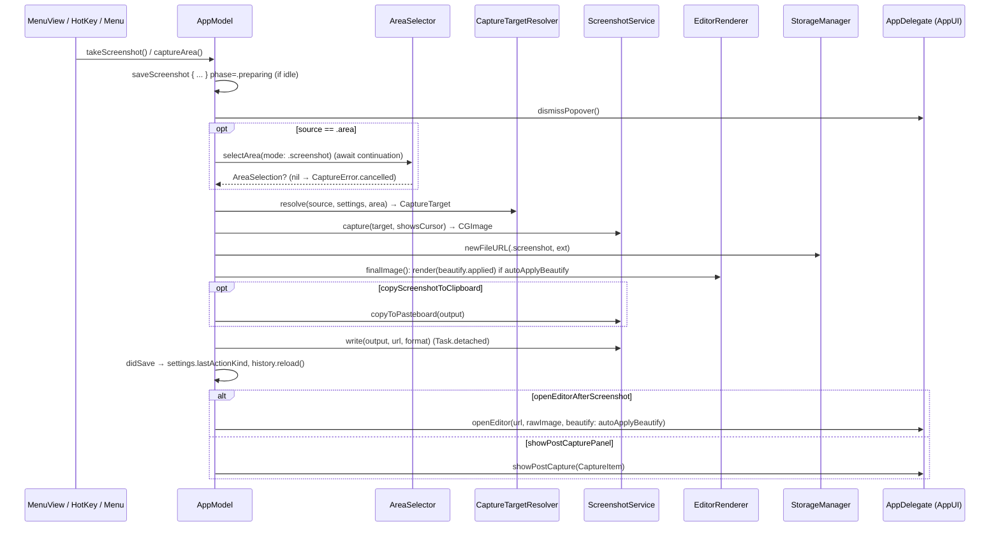
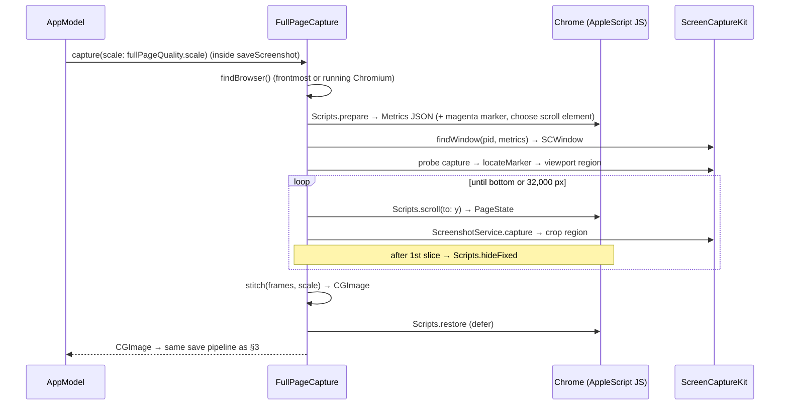
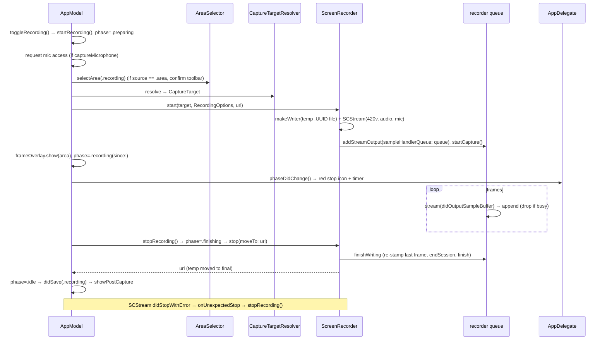
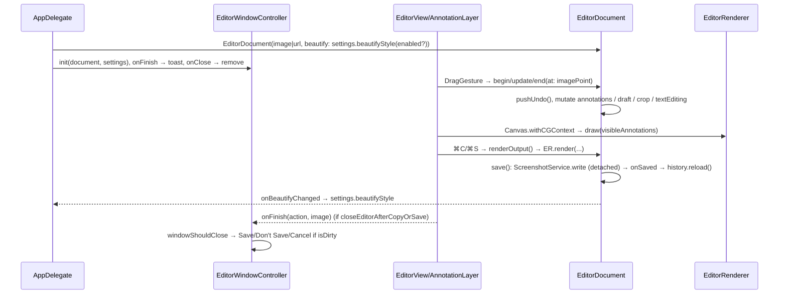

# Flows & Graphs (Mermaid)

## 1. File dependency graph

Arrow = "references a type declared in". Generated data: [graph.json](graph.json). Leaf models omitted from
some arrows for readability (almost every file uses `Models/Models.swift`).

Notable couplings: `SettingsStore → EditorDocument` (persists `BeautifySettings`), `MenuView → ScreenRecorder`
(uses `RecordingOptions` to preview resolution/bitrate), `EditorDocument ↔ EditorRenderer` (mutual).

## 2. Startup

## 3. Screenshot (button / ⌃⌥⌘S / ⌃⌥⌘A area)

## 4. Quick Screenshot (⌃⌥⌘D)

`AppModel.quickScreenshot` → display under mouse → `CaptureTargetResolver.resolve(.display, displayID:)` →
`ScreenshotService.capture` → `finalImage` → **always** copy to clipboard → shutter sound (optional) → write →
`history.reload()` → `ui.showQuickCaptureToast` (click → `openEditor`). No editor/post-capture panel.

## 5. Full-page Chrome screenshot (⌃⌥⌘F)

## 6. Recording (⌃⌥⌘R / status item)

## 7. Editor lifecycle

## 8. Hot keys & settings change

`SettingsView/ShortcutRecorder` → `HotKeyManager.suspend()` while capturing a key → `settings.setShortcut` →
`SettingsStore.shortcuts.didSet` → `onShortcutsChanged` → `AppDelegate.registerHotKeys()` →
`HotKeyManager.configure` → Carbon `RegisterEventHotKey` (failures → `failedActions`, shown in Settings).
