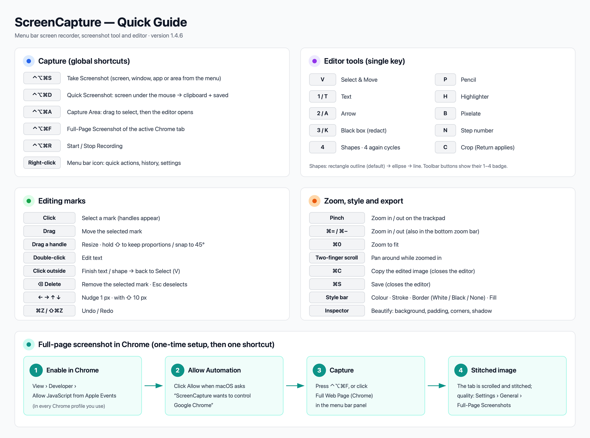
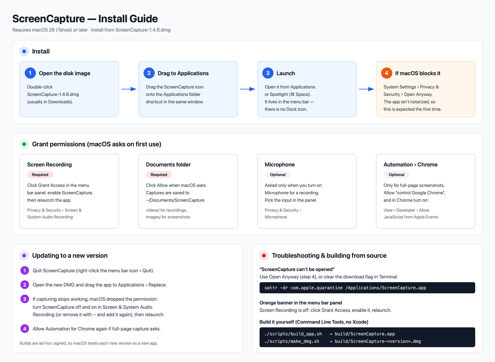

# ScreenCapture

A menu bar screen recorder and screenshot tool for **macOS 26 (Tahoe) and later**. It's built with ScreenCaptureKit, hardware-encoded AVFoundation, and SwiftUI with Liquid Glass. The UI is modeled on Tap Record.

## User guide



The source is [docs/user-guide.svg](docs/user-guide.svg).

## Install guide



The source is [docs/install-guide.svg](docs/install-guide.svg).

## Features

- **Record or screenshot** from a compact menu bar panel.
- **Sources:** a whole screen, a single window, a single app (only that app's windows and audio), or a dragged **area**.
- **Area selection:** a red selection frame with crosshair guides and a live pixel-size label. For screenshots, capture happens on release (like ⌘⇧4). For recordings you can move or resize the frame, then press **Start Recording** or Return. A single click selects the whole screen, and Esc cancels.
- **Frame rate:** 15 / 24 / 30 / 60 / 120 fps.
- **Quality:** Low (50% resolution), Medium (75%), High (native), Best (native, maximum bitrate). The panel shows the resulting resolution and bitrate. Other options: HEVC or H.264, MP4 or MOV.
- **Audio:** system audio and/or microphone, each on its own track, with a microphone picker. The cursor can be shown or hidden.
- **Screenshots:** PNG, JPEG, or HEIC, with optional copy to the clipboard.
- **Quick Screenshot:** one shortcut (default `⌃⌥⌘D`, changeable in Settings › General or Shortcuts) instantly captures the screen under the mouse. It copies the image to the clipboard, saves it to `ScreenCapture/images`, plays a shutter sound (optional), and shows a small toast; click the toast to open the editor.
- **Full-page web screenshots (Chrome):** `⌃⌥⌘F`, the *Full Web Page (Chrome)* button, or the right-click menu scrolls the active tab of the front Chrome window (Chromium, Brave and Edge work too), captures it slice by slice, and stitches the whole page into one image. Fixed and sticky headers appear only once, and the page's scroll position is restored afterwards. One-time setup: in Chrome, turn on **View › Developer › Allow JavaScript from Apple Events**, then allow ScreenCapture to control Chrome when macOS asks. Pages that scroll inside an inner panel instead of the main document (Jira, Gmail and similar web apps) are handled by scrolling and capturing that panel. Very long pages are cut off at 32,000 px.
- **Capture Text (OCR):** `⌃⌥⌘T` (or the right-click menu) lets you drag over any area and copies the text in it, without saving a file. English, Vietnamese and other languages are detected automatically, all on-device. The editor (*Copy Text (OCR)* in the side panel) and History (right-click a screenshot › *Copy Text*) can do the same for existing screenshots.
- **Pin to screen:** `⌃⌥⌘P` (or the right-click menu) lets you drag over an area and keeps it floating on top of other windows, exactly where it was. You can also pin from the preview card (pin button), the editor (*Pin to Screen*), or History (right-click › *Pin to Screen*). Drag a pin to move it; drag an edge, scroll or pinch to resize it; press Esc or click ✕ to close it. Right-click a pin to copy, save, edit, change its opacity, or close all pins.
- **Screenshot editor (Xnapper-style):** opens automatically after each screenshot (configurable). Tools: select/move (V), text (1 or T), arrow (2 or A), black box (3 or K), shapes (4: rectangle outline by default; press 4 again to switch to ellipse or line; also R, O, L), pencil (P), highlighter (H), pixelate/redact (B), numbered steps (N), and crop (C). Click any mark to select it, then drag it to move or drag its handles to resize (Shift keeps proportions); double-click text to edit it. While typing text, press Return to finish and Shift+Return for a new line, so you can enter several lines at once. Zoom with a trackpad pinch, ⌘+ / ⌘− / ⌘0, or the zoom bar at the bottom of the editor; scroll to pan when zoomed in. You can set colour, stroke, border (white by default, or black or none), fill, and text size; hold Shift for squares and 45° lines; and use undo/redo and arrow-key nudging. **Beautify** places the shot on a background (gradient preset, solid colour, custom two-colour gradient with a direction, or your own image) with padding, rounded corners, a shadow, and an aspect ratio (Auto, 16:9, 4:3, 1:1). **Extra space** (side panel › Canvas: S / M / L) adds blank room around the screenshot, and marks and text are not clipped to the screenshot, so you can draw or type outside it (over the extra space or the Beautify background). Open editor windows are also included in screenshots, so you can capture an edit in progress. Copy (⌘C), Save (⌘S), and Save As are available. By default ⌘C and ⌘S also close the editor and show a toast (click it to reopen); turn this off in Settings › General.
- **Auto-apply Beautify:** in Settings › Beautify, choose a default style and apply it to every new screenshot, Quick Screenshots included. The clipboard and saved file get the styled image, and the editor opens with Beautify on, still editable. Style changes made in the editor become the new default. The preview and the exported file are drawn by the same renderer, so they match exactly.
- **Auto-created folders:** `~/Documents/ScreenCapture/videos` and `~/Documents/ScreenCapture/images`.
- **After each capture:** a floating card shows a preview with *Open / Finder / Copy*, plus **View Recording History** or **View Screenshot History**, matching the capture you just made. Previews stack: take several captures in a row and up to three cards (and Quick Screenshot toasts) stay visible, newest at the bottom; hover one to keep it open.
- **Trim recordings:** click *Trim* on the card after a recording, or right-click a recording in History › *Trim…*. Drag the yellow handles (like QuickTime) and press *Trim*. The cut is saved without re-encoding, so it's instant and lossless; the trimmed video replaces the original, which goes to the Trash.
- **History window:** double-click a screenshot to edit it. It's a grid grouped by date, with search, a preview inspector (video player or image plus metadata), drag-and-drop, share, and move to Trash. It updates live when files change.
- **Global shortcuts:** customise them in **Settings › Shortcuts** (gear button, or ⌘,). Defaults: `⌃⌥⌘S` takes a screenshot, `⌃⌥⌘D` takes a quick screenshot, `⌃⌥⌘A` captures an area, `⌃⌥⌘F` takes a full-page Chrome screenshot, `⌃⌥⌘T` captures text (OCR), `⌃⌥⌘P` pins an area, and `⌃⌥⌘R` starts or stops recording. While recording, the menu bar shows a red stop icon and a timer; click it to stop.
- **Right-click the menu bar icon** for quick actions and both history views.

## Performance notes

- Frames go from ScreenCaptureKit straight to the hardware encoder in YUV 4:2:0 (`420v`). There's no colour conversion or copying.
- All writer work runs on one serial queue, with no locks. If the encoder is busy, frames are dropped rather than blocking capture.
- Idle frames are skipped, and when the screen is static at the end, the last frame is re-stamped at stop time so the clip isn't cut short.
- Output size is clamped to encoder limits: H.264 up to 4096×2304, HEVC up to 8K.
- Recordings are written to a hidden temporary file and renamed when finished, so incomplete files never show up in History.
- Thumbnails come from QuickLook and are cached in a bounded `NSCache`. Folder scans run off the main thread and are triggered by file-system events.

## Build & run

Xcode isn't required; the Command Line Tools are enough.

```bash
./scripts/build_app.sh          # release build -> build/ScreenCapture.app
open build/ScreenCapture.app
```

Options: `CONFIG=debug ./scripts/build_app.sh`, or set `SIGN_IDENTITY="Apple Development: …"` to sign with your own certificate. You can also open `Package.swift` in Xcode.

### DMG installer

```bash
./scripts/make_dmg.sh               # builds the app, then build/ScreenCapture-<version>.dmg
SKIP_BUILD=1 ./scripts/make_dmg.sh  # package the existing build/ScreenCapture.app
```

The disk image contains the app and an `Applications` shortcut, so you can drag to install.

### Permissions

On first use, macOS asks for:

1. **Screen & System Audio Recording.** Required. If the panel shows the orange banner, click **Grant Access** and enable ScreenCapture. If capture still fails, relaunch the app.
2. **Documents folder.** Needed to save files.
3. **Microphone.** Only if you enable it.
4. **Automation (Chrome).** Only for full-page web screenshots.

> The default build is ad-hoc signed. macOS ties permissions to the code signature, so after a rebuild you may need to re-enable ScreenCapture under *System Settings › Privacy & Security › Screen & System Audio Recording*. Signing with a real identity (`SIGN_IDENTITY`) avoids this.

## Project layout

```
Sources/ScreenCapture/
  App/        main entry, AppDelegate (status item, popover, menus), AppModel (coordinator), window controllers, pins
  Models/     option enums and the persisted SettingsStore
  Services/   ScreenRecorder (SCStream → AVAssetWriter), ScreenshotService, TextRecognizer (OCR), CaptureTargetResolver,
              AreaSelector, ShareableContentStore, HistoryStore, ThumbnailCache, HotKeyManager, StorageManager
  Views/      MenuView (panel), HistoryView, PostCaptureView, shared views
Resources/Info.plist
scripts/build_app.sh, scripts/make_icon.swift
```
